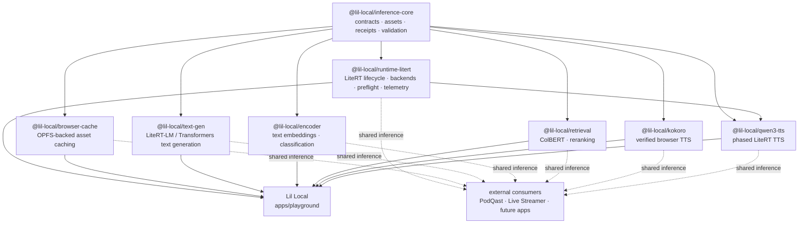

# Lil Local

**Small footprint. Real local inference.**

A local-first browser inference lab, model launcher, runtime qualification workspace, and reusable LiteRT.js ecosystem.

Lil Local is both the interactive browser app in `apps/playground` and the
reusable `@lil-local/*` library family. The app and packages are two faces of
the same project.

The goal is simple: **prove a capability once, package it once, and consume it
everywhere** instead of rebuilding browser inference plumbing in every app.

Lil Local is built around a deliberately boring workflow:

1. browse models without triggering a download
2. explicitly download and load the model you actually want
3. see which backend really resolved
4. run preflight and real inference
5. capture enough evidence to reuse that working path elsewhere

The workspace covers text, retrieval, speech, audio, vision, OCR, image
embeddings, video classification, and related local inference workloads.

### MediaPipe Universal Embedder + Semantic Retriever

The opt-in `@lil-local/retrieval-mediapipe` package turns the
[official MediaPipe Web Samples](https://github.com/google-ai-edge/mediapipe-samples-web)
Universal Embedder and Semantic Retriever into **one reusable, cold-loaded
model session**. It supports real text/image/audio embedding and a local
in-memory semantic index, using one shared native provider rather than a
separate model per task. The playground accepts an explicit `.litertlm`
file or URL; the pinned official 165 MB text model has been qualified
in Chromium with **768-dimensional text embeddings** and native text
search. Image/audio model execution requires separately selected
Text-Vision/Omnimodal weights and is not claimed qualified.
See [usage](packages/retrieval-mediapipe/README.md) and
[source-to-substrate verification](docs/verification/2026-11-04-mediapipe-samples-retrieval.md).

### MediaPipe Audio as a reusable substrate

The opt-in `@lil-local/audio-mediapipe` package provides real MediaPipe
Tasks Audio APIs for pinned **YAMNet** sound classification, existing
**Parakeet** speech transcription, and optional caller-selected LiteRT-LM
**TTS**. The playground now consumes the shared Parakeet loader and can
run local YAMNet classification; its real-browser inference is covered by
`pnpm test:audio:browser`. Other projects import the same package rather
than duplicating the task SDK. Neither Parakeet nor TTS are claimed to have
passed large-model real inference yet. See
[usage](packages/audio-mediapipe/README.md) and
[verification](docs/verification/2026-11-04-mediapipe-audio-substrate.md).

### Language identification as a reusable text substrate

`@lil-local/text-mediapipe` adds Google's **315 KB SHA-256-verified
MediaPipe Language Detector** with scored, native language codes.
It uses a separate opt-in text playground, without automatic
translation, TTS voice selection, transcript modification or
camera permissions. Real Chromium classified English (`en`),
Spanish (`es`) and Japanese (`ja`) samples correctly, using
the actual model and the MediaPipe WebGL delegate. **WebGL is not
WebGPU**, and three passages do not establish language-recognition
accuracy in general. The native detector is cold until explicit
load, and an external packed consumer uses the same public API.

See [package usage](packages/text-mediapipe/README.md) and
[actual model/browser qualification](
docs/verification/2026-11-04-mediapipe-language-detection.md).

### MediaPipe Vision as a reusable substrate

The opt-in `@lil-local/vision-mediapipe` package provides verified, locally
executed face landmarks/blendshapes, hand gesture recognition, and full-body
pose/world-landmark detection, **EfficientDet-Lite0 object detection**
with scored labels and pixel-space bounding boxes, and **EfficientNet-Lite0
whole-image classification** with scored ImageNet categories. The same
package now includes **Holistic Landmarker**, one shared face/body/hands
model session with world landmarks and native left/right hands, plus
**DeepLab V3 semantic segmentation** with true per-pixel class IDs, not
a prompt-conditioned SAM mask. It also includes **BlazeFace Short Range**
for inexpensive face bounding boxes and six keypoints without full face
mesh inference; its optional GPU delegate uses MediaPipe WebGL, not WebGPU. The playground has a **MediaPipe Vision** test
entry with opt-in still-image analysis and webcam tracking; external applications
consume the same typed package rather than rebuilding MediaPipe lifecycle
code. No model downloads or webcam access happen until explicit activation.
See [package usage](packages/vision-mediapipe/README.md) and
[the original browser verification](docs/verification/2026-11-04-mediapipe-vision-substrate.md),
[pose qualification](docs/verification/2026-11-04-mediapipe-pose-substrate.md), and
[object detection qualification](docs/verification/2026-11-04-mediapipe-object-detection.md),
[image classification qualification](docs/verification/2026-11-04-mediapipe-image-classification.md),
[holistic qualification](docs/verification/2026-11-04-mediapipe-holistic-landmarker.md),
[semantic class-mask qualification](docs/verification/2026-11-04-mediapipe-semantic-segmentation.md),
and [lightweight face detection qualification](docs/verification/2026-11-04-mediapipe-blazeface-detector.md).

### MagicTouch V2 — stateful interactive selection

The opt-in **MagicTouch V2** path in `@lil-local/vision-mediapipe`
uses one 30.5 MB SHA-verified native model to **encode a still image
once, then repeatedly refine its soft mask with include/exclude/lasso
strokes**. A separate playground workbench provides direct on-image
drawing, cumulative strokes, Undo, Clear and model Unload. Unlike
SAM 2.1's existing one-shot point-prompted function, this exposes
a persistent native image session; it **does not replace SAM** or
promise better accuracy. Real Chromium changed selection coverage
from **42.4%** to **8.0%** after a negative stroke, but CPU/WASM
took **several seconds per stroke**. No webcam, app integrations,
hidden model downloads or GPU performance claims.

See [usage](packages/vision-mediapipe/README.md) and
[qualified model/real browser receipt](
docs/verification/2026-11-04-mediapipe-interactive-segmentation.md).

## What it provides

### Lil Local model library

The playground is a model launcher rather than a click-to-download catalog.

- selecting a model is side-effect free
- downloads happen only from an explicit model action
- downloaded assets are tracked in Lil Local's own browser Cache Storage library
- downloaded bytes and compiled in-memory state are treated separately
- a stored model can be loaded again without redownloading
- models can be unloaded from memory without deleting their downloaded assets
- individual stored models can be removed, or the managed model library can be cleared
- model cards expose a plain-language description before the technical details
- model-family color and icons provide quick visual orientation without replacing the model name

Special multi-graph experiences such as Qwen3-TTS and the Gemma/LFM pipeline page
also require an explicit load/prepare action instead of doing heavy runtime work just
because the page was opened.

### Lil Local guide

The Tart mascot is bound to real runtime state rather than a separate assistant layer
state machine. It reacts to model selection, download/compile progress, backend
resolution, fallback events, preflight, real inference, and runtime errors.

When enough evidence exists, the UI can show a current-session runtime receipt/path
proof separately from the adapter's durable verification level. A successful session
does **not** silently promote repository verification metadata.

The longer-term product direction is for Tart to turn a proven local runtime path into
an "add this to my app" recipe without guessing from UI state.

### Browser inference substrates

Lil Local is growing beyond LiteRT: `inference-core` now exposes a
`BrowserSubstrateRunner` interface for explicitly loaded browser engines.
The existing real D1 ONNX Runtime Web panel uses it; the established LiteRT
runner remains unchanged. GGUF and other engines remain unqualified candidates,
not silently added dependencies or models.

See [browser inference substrates](docs/web-substrates.md) for implementation
boundaries, evidence requirements, and further paths.

### Shared LiteRT runtime

`@lil-local/runtime-litert` wraps `@litertjs/core` with the lifecycle and
runtime behavior needed by real applications:

- WebGPU, WebNN, and WASM capability probing
- automatic backend order: **WebGPU → WebNN → WASM**
- strict behavior when a backend is explicitly requested
- compiled-model caching
- concurrent load deduplication
- caller-specific cancellation for deduplicated loads
- safe invalidation of pending loads during model disposal
- named-signature inference
- model preflight with bounded synthetic inputs
- automatic cleanup of temporary preflight tensors and outputs
- shared inference coordination for serialized accelerator work
- compile, inference, fallback, and preflight telemetry
- bounded telemetry history
- tensor helpers and GPU-buffer capability probing
- safe model/runtime disposal

The existing lightweight `RuntimeContext` contract remains usable by model
packages that only need `loadModel`, `loadNpy`, and `fetchBuffer`. The managed
runtime is additive rather than a replacement for those package contracts.

### Playground dogfooding

The React playground uses `@lil-local/runtime-litert` itself. It does not
maintain a separate private LiteRT loader.

That means runtime behavior exercised in Lil Local is the same behavior intended for
downstream consumers. The UI exposes:

- requested vs. resolved accelerator
- compile timing
- fallback count
- model preflight
- preflight timing and output count
- recent runtime/inference events
- current-session runtime path proof
- durable adapter verification evidence separately from current-session runtime state

Changing the requested accelerator unloads the current model. Lil Local does not
silently recompile or download a different path behind the user's back; loading is an
explicit action.

## Architecture



The dependency direction is intentionally generic → specific. Product concepts
such as episodes, stream state, OBS control, game logic, or UI semantics belong
in consuming applications rather than in the shared runtime packages.

## Workspace layout

| Path | Package | Purpose |
|------|---------|---------|
| `apps/playground` | `playground` | **Lil Local** — React + Vite + Tailwind model launcher and qualification UI |
| `packages/inference-core` | `@lil-local/inference-core` | Model manifests, asset resolvers, receipts, capability selection, validation, errors, shared contracts |
| `packages/runtime-litert` | `@lil-local/runtime-litert` | Managed LiteRT.js runtime, backend selection, compiled-model lifecycle, preflight, coordination, telemetry |
| `packages/browser-cache` | `@lil-local/browser-cache` | Browser-side model/tensor cache primitives for reusable consumers |
| `packages/kokoro` | `@lil-local/kokoro` | Kokoro TTS through `kokoro-js` using q8/WASM |
| `packages/qwen3-tts` | `@lil-local/qwen3-tts` | Phased Qwen3-TTS pipeline over talker, MTP, and codec LiteRT graphs |
| `packages/text-gen` | `@lil-local/text-gen` | `LiteRtLmTextPipeline` over `@litert-lm/core` plus LFM2.5, Gemma 4, and Qwen3 manifests |
| `packages/text-mediapipe` | `@lil-local/text-mediapipe` | Small SHA-verified MediaPipe language-ID model, native text/WASM lifecycle and scored ISO codes |
| `packages/retrieval` | `@lil-local/retrieval` | `ColBertPipeline`, multi-vector embeddings, and late-interaction scoring |
| `packages/encoder` | `@lil-local/encoder` | Text embeddings and token-classification pipelines |
| `packages/image-embedding` | `@lil-local/image-embedding` | Reusable image-embedding package |
| `packages/video-classification` | `@lil-local/video-classification` | Browser video-classification support and runtime checks |
| `packages/depth-estimation` | `@lil-local/depth-estimation` | Canonical `DepthFrame` contract and reusable monocular-depth pipeline |
| `packages/image-segmentation` | `@lil-local/image-segmentation` | On-demand face parsing, SAM 2.1 point-prompted masks, and an opt-in U²-Net foreground-matte candidate |
| `packages/decision-onnx` | `@lil-local/decision-onnx` | Opt-in D1 Omni ONNX WebGPU text-decision slice |
| `packages/pix2pix-webgpu` | `@lil-local/pix2pix-webgpu` | Opt-in Rust/Wasm custom WebGPU Pix2Pix U-Net 256 image translation |
| `packages/embedding-litertlm` | `@lil-local/embedding-litertlm` | Opt-in LiteRT-LM EmbeddingGemma 2 WebGPU text embeddings |
| `packages/react-litert` | `@lil-local/react-litert` | React bindings for the managed LiteRT runtime |
| `packages/moderation` | `@lil-local/moderation` | Opt-in Apache-2.0 content-safety classifier (Transformers.js ONNX, WebGPU/WASM) |
| `examples/minimal-kokoro` | `@lil-local/example-kokoro` | Minimal standalone Kokoro browser example |
| `examples/minimal-qwen3-tts` | `@lil-local/example-qwen3-tts` | Minimal Qwen3-TTS example and compatibility harness |

Workspace globs cover `apps/*`, `packages/*`, and `examples/*`.

## Quick start

Requirements:

- Node.js 22+
- pnpm 11+

```bash
pnpm install
pnpm dev
```

The development command starts Lil Local from `apps/playground`.

### MediaPipe worker engine

`@lil-local/text-gen` also exposes a shared worker surface with an
explicit `mediapipe` engine for structured text/image/audio prompts. Image
Blobs are decoded to worker-native `ImageBitmap` sources; audio crosses the
worker boundary as PCM `Float32Array` samples plus an explicit sample rate.
The client intentionally preserves caller ownership of PCM arrays, so worker
`postMessage` structured-clones that audio buffer once instead of detaching it;
consumers should account for that copy when sending long clips.

Blob-backed model loads use object identity by default. Consumers that may
recreate the same cached Blob while a load is already in flight can provide a
stable `loadKey` in the worker load options to opt into safe deduplication;
Lil Local does not guess model identity from Blob size/MIME metadata.
The worker's `advertisedEngines` list is a build-time statement only; consumers
must treat a successful `load()` as the runtime availability check for the
chosen browser, model, WebGPU environment, and host policy. Direct worker
protocol consumers receive a terminal `cancelled` response. The bundled
`LiteRtLmWorkerClient` instead rejects its own `AbortSignal` immediately and
treats the later worker cancellation acknowledgement as informational, so
caller abort latency does not depend on native worker teardown.

By default, the MediaPipe engine resolves its pinned `@mediapipe/tasks-genai`
WASM files from jsDelivr. Offline, air-gapped, or strict-CSP consumers should
self-host those WASM assets and pass their own `mediaPipe.wasmBaseUrl` during
`load()`. Sampling/context options supported by MediaPipe are likewise set at
load time; the worker rejects per-generation config rather than silently
dropping unsupported caller intent.

Before merging runtime or package changes, run:

```bash
pnpm verify
```

`pnpm verify` is also the authoritative deterministic CI gate. Real browser
qualification is a separate evidence-producing step; see [Verification philosophy](#verification-philosophy).

## Commands

| Command | Runs |
|---------|------|
| `pnpm install` | Install workspace dependencies |
| `pnpm dev` | Start the playground dev server |
| `pnpm build` | Build all workspace projects |
| `pnpm preview` | Preview the playground production build |
| `pnpm test` | Run tests in all workspace projects |
| `pnpm test:boundaries` | Verify package dependency and architecture boundaries |
| `pnpm test:compatibility` | Pack and consume the supported external package surface |
| `pnpm test:conversion-assets` | Validate pinned conversion recipes and candidate-evidence boundaries |
| `pnpm test:qualification` | Run deterministic runtime-qualification contract tests |
| `pnpm test:webgpu-kernel-probe` | Test WebGPU matmul workgroup-selection heuristics (fail closed on inaccurate output) |
| `pnpm qualify` | Run real browser qualification cases and write evidence results |
| `pnpm probe:webgpu-matmul` | Opt-in real-Chromium WebGPU matmul microkernel probe; measurement only, not an execution provider |
| `pnpm test:watch` | Watch-mode tests for the playground |
| `pnpm typecheck` | Type-check all workspace projects |
| `pnpm verify` | Typecheck + tests + WebGPU kernel probe + boundaries + compatibility + conversion assets + qualification contracts + builds |

Conversion inputs and candidate evidence live under `conversion/`. Android
CompiledModel observations can guide what Lil Local tries next, but they do not
promote browser verification metadata; browser claims still require Lil Local's
own recorded qualification evidence.

GitHub Actions runs the deterministic `pnpm verify` gate for pull requests. The
`Runtime qualification` workflow runs `pnpm qualify` on demand and uploads its
evidence artifacts.

## Runtime example

Inside the workspace, a managed LiteRT runtime can be created from the shared
asset resolver and runtime packages:

```ts
import { createHttpAssetResolver } from '@lil-local/inference-core'
import { createLiteRtRuntime } from '@lil-local/runtime-litert'

const context = await createLiteRtRuntime({
  backend: 'auto',
  assets: createHttpAssetResolver('https://example.com/models/'),
})

const model = await context.liteRt.loadModel('model.tflite')

console.log(context.backend)
console.log(context.liteRt.getModelInfo('model.tflite'))
```

Model qualification can use the same runtime:

```ts
const result = await context.liteRt.preflight('model.tflite')

console.log({
  backend: result.resolvedBackend,
  compileMs: result.compileDurationMs,
  inferenceMs: result.inferenceDurationMs,
  outputs: result.outputCount,
})
```

Preflight-generated input tensors and discarded output tensors are owned and
cleaned up by the runtime. Inputs supplied through a custom `createInputs`
callback remain caller-owned.

## TTS capability status

| Capability | Backend | Status |
|------------|---------|--------|
| **Kokoro** | Browser WASM (`kokoro-js`, q8) | **Verified** audible browser synthesis at 24 kHz mono |
| **Qwen3-TTS** | Native/local LiteRT runtime | **Classified native/local** rather than practical browser-WASM |

### Kokoro

Kokoro is the current verified browser TTS path. The package has produced real
audible browser output, not merely a successful build or mocked inference call.

`@lil-local/kokoro` also serves as the first real external shared-package
consumer path from this repository.

### Qwen3-TTS

Qwen3-TTS is represented as three host-orchestrated LiteRT graphs:

1. talker
2. MTP
3. codec

The current model set exceeds the practical browser WASM/JavaScript memory
budget during prefill, even after experiments with MTP quantization, prompt and
codec residency, reduced KV capacity, and browser-memory variants.

The playground graph-set selector defaults to the published `fp32` assets.
The `browserMemory` manifest variant is explicitly labeled experimental and
requires `talker_int4.tflite` plus the local `mtp_folded_int8.tflite`; it is
not silently substituted for the published default. That reduced-memory variant
and short-KV talker exports remain useful compatibility probes for future
LiteRT.js/runtime improvements. The package architecture remains valuable for
native/local LiteRT consumers even where browser-WASM is not practical.

## Verification philosophy

A build passing does **not** mean a model works.

The repository separates:

- package/type correctness
- runtime compilation
- real inference
- output validation
- manual audible/visual verification where appropriate

Lil Local makes the same distinction in adapter metadata. Every adapter has
an evidence level; adapters without an explicit `verification` record are shown
as **Registered** rather than implicitly treated as working.

The levels are monotonic claims about captured evidence:

| Evidence level | Meaning |
|----------------|---------|
| `registered` | Adapter/model wiring exists; no runtime claim is implied |
| `compile-verified` | The model compiled on the recorded backend |
| `inference-verified` | Real inference completed on the recorded backend |
| `output-verified` | Inference completed and output passed model-specific validation |
| `manually-verified` | Human-observable output was checked where semantic quality cannot be established mechanically (for example audible TTS or visual output) |

An adapter verification record may also name the backend(s), verification date,
and a repository path or URL containing the evidence. Current-session UI state
such as “Ready”, compile timing, or a successful preflight never upgrades this
durable evidence level by itself.

`pnpm verify` validates code, contracts, tests, package boundaries, and builds. It
does **not** by itself prove every registered adapter has successfully run its
real model. Use `pnpm qualify` (or the manually dispatched `Runtime qualification`
workflow) for browser-observed qualification cases, and only promote an adapter's
verification level when the corresponding evidence exists.

Real-model and audio findings are kept under `docs/verification/`. No capability
should be promoted to “working” from build output alone.

## Package boundaries

The repository includes boundary tests to keep the shared layer genuinely
shared. In particular:

- examples should consume public package entrypoints
- `inference-core` must remain independent of model-specific packages
- the playground must consume `runtime-litert` instead of recreating LiteRT
  loading directly
- runtime policy must remain product-independent

A useful extraction rule is:

> If the code still makes sense when none of the consuming products exist, it is
> probably a package candidate.

## External consumption

Consuming applications should pin every shared inference package to one **Lil
Local** Git SHA. The canonical repository is `myrqyry/lil-local`; the package
namespace is `@lil-local/*`. The project and package namespace were renamed from
Lil Tart / `@litert-playground/*` together, so the repository rename does not
create a gratuitous package-API migration.

See [Package revision policy](docs/package-revision-policy.md) for the exact
pinning rules and the supported compatibility surface.

The downstream local-inference stack is now exercised as an actual packed
external consumer, not merely as workspace imports. The compatibility gate
covers:

- runtime contracts + LiteRT lifecycle: `inference-core`, `runtime-litert`
- browser asset persistence: `browser-cache`
- local language generation: `text-gen`
- embeddings and RAG primitives: `encoder`, `retrieval`
- speech generation: `kokoro`, `qwen3-tts`
- reusable image/video inference packages

Packages remain `private: true` because they are not registry releases. They are
still intentionally consumable through SHA-pinned Git `path:` dependencies;
`pnpm test:compatibility` packs, installs, type-checks, and builds that external
surface. Product-specific worker orchestration, playback, UI state, and
persistence stay in the consuming application.

## Project direction

Lil Local is intended to be the qualification and shared-infrastructure home for
reusable local inference capabilities:

```text
prove model/runtime behavior
        ↓
add verification + receipts
        ↓
generalize the reusable layer
        ↓
publish/expose a package boundary
        ↓
consume it from applications
        ↓
feed generic improvements back into playground
```

The result should be fewer copied runtimes, fewer product-specific inference
forks, and a much clearer answer to the important question: **does this model
actually work in this environment, on this backend, with evidence?**

## License

Shared packages are currently licensed under Apache-2.0 as declared by their
package manifests.
